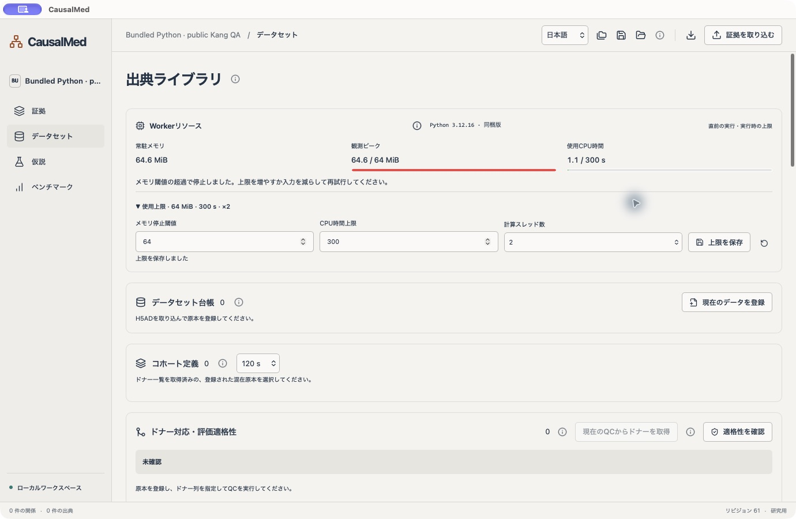
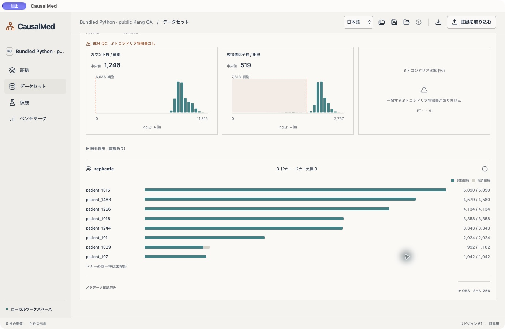
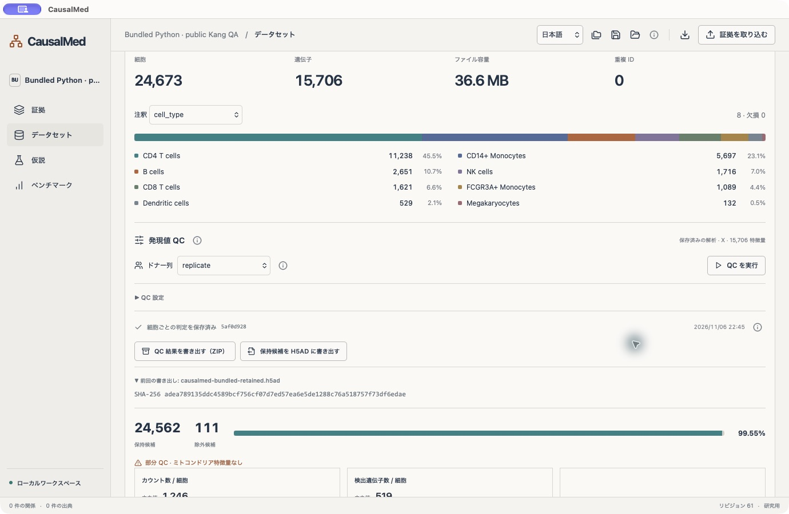

# CausalMed

CausalMed is a local, evidence-first desktop workspace for researchers studying biomedical causal relationships. It brings source records, single-cell datasets, falsifiable hypotheses, and reproducible evaluation into one visual workbench.

The project begins with the research questions discussed in “医学AIの活用例” and uses idiopathic pulmonary fibrosis (IPF) as its initial organizing context. Its purpose is to help researchers move from an interesting association to a clearly stated, testable intervention hypothesis, while preserving the evidence and uncertainty behind that hypothesis.

**Status: early research software.** The app can inspect evidence, import H5AD files, save expression quality-control decisions, export retained cells as a new H5AD, map a donor annotation, inspect real count-expression outcomes by donor, and run a guarded scalar M0 baseline when all prerequisites pass. A separate synthetic baseline remains available for pipeline checks. It has not established a new treatment target, demonstrated causal discovery performance, or validated clinical predictions. Public PBMC datasets are used to test ingestion and QC; they do not validate the IPF research hypothesis.

## Screenshots

Native macOS app shown in Japanese; English and Simplified Chinese are also supported. These screens use public Kang data for workflow verification, not biological or clinical validation.



The app carries its own Python 3.12.16 runtime. Resource-budget stops preserve the last successful QC result; memory is a sampled stop threshold, not an instantaneous allocation cap.



The relocated bundled app inspected 24,673 cells × 15,706 genes and retained 24,562 candidates. Missing mitochondrial features remain explicitly marked as partial QC.



A new H5AD contains the retained cells and recorded QC provenance. The source stays unchanged, and the output receipt records its SHA-256.


QC history selection stays across pages, searches and filters. The toolbar counts selected items outside the current page before a bulk action.


Project organization supports the same page-spanning selection and reversible bulk trash/restore. The active project is protected from selection.

## Why this project exists

A molecular association, an intervention experiment, and a proposed mechanism answer different questions. A useful research tool should keep those distinctions visible throughout the workflow. It should also make it possible to trace a claim back to its source, compare contradictory records, identify differences in experimental conditions, and state what future result would disprove a proposed explanation.

CausalMed is designed around that workflow:

1. **Inspect the evidence.** Review a relationship together with its source, excerpt, cell model, experimental context, and explicitly linked contradictory records.
2. **Understand the data.** Inspect an H5AD dataset's dimensions, annotations, count distributions, missing values, and donor structure before attempting evaluation.
3. **Form a falsifiable hypothesis.** Describe the intervention, its context and controls, and a concrete falsification criterion. A saved hypothesis remains unvalidated.
4. **Evaluate without confusing cells with independent replicates.** The current synthetic M0 protocol separates datasets, perturbations, and donors, and aggregates measurements at donor level. Actual H5AD outcomes are not connected to this evaluator yet.
5. **Escalate model complexity only with evidence.** M1 and more advanced models belong after reliable baselines, independent evaluation, calibration, and explicit abstention rules.

The intended output is an inspectable research argument and a reproducible experiment plan. Source provenance and uncertainty are part of the result, rather than information to hide behind a single score.

## Visual interaction

The interface prioritizes compact panels, direct manipulation, and visual summaries. Evidence is shown in a searchable relationship ledger with a detachable inspector. Dataset annotations use composition bars and labeled proportions. Expression QC uses histograms, threshold markers, a retention summary, and per-donor comparison bars. Explanations are available through information icons.

The interface supports English, Japanese, and Simplified Chinese. Scientific annotation values are preserved as supplied by the dataset. The renderer currently previews one relationship in a native GPU window; full-network exploration and cell embeddings are planned.

## Current capabilities

- Distinct observation, intervention, and hypothesis records, with provenance and contradictory-record links.
- Validated evidence JSON imports with SHA-256 provenance, duplicate rejection, and transactional SQLite persistence.
- Hypothesis drafts with required intervention plans and falsification criteria; draft, planned, and archived states.
- Right/bottom docking and a floating inspector synchronized through Rust-owned state.
- Local H5AD metadata ingestion, expression QC, configurable thresholds, and explicit donor-column mapping.
- Project-owned dataset registry keyed by full-file SHA-256: provenance, source version, license/citation, user review status, annotation schema and explicit donor/condition/perturbation/cell-type column roles. Source-specific QC history filters and live/trash counts keep multiple datasets distinguishable.
- Immutable per-cell QC decisions, complete QC archives (ZIP), and retained-cell H5AD exports with embedded conditions and provenance.
- Managed Python worker with progress, cancellation, configurable deadlines, child-process cleanup, and preservation of the last successful result on failure.
- Synthetic donor-weighted M0 evaluation with a reproducible manifest, plus an independent Python reference CLI.
- Portable `.causalmed` project packages with the research workspace, all normal and trashed committed QC histories, conditions, donor mappings, cell decisions and selected result. SHA-256 checks protect each packaged artifact.
- Restore into a new local project generation, then reconnect relocated original H5ADs by full-file SHA-256. Matching histories share the verified source binding. JSON research snapshots remain available separately.

To register a source, open **Datasets**, import an H5AD (or select a saved result), then choose **Register current dataset**. The pencil control edits provenance and column roles; the filter icon narrows QC history to that exact source without changing the selected QC result. Registry roles are descriptive and do not silently change QC donor mappings. Review requires a source URL, version, license and citation, and records the user's attestation rather than independent license or scientific validation. Source metadata is included in project packages; original matrices remain external. Registries are limited to 128 sources / 4 MiB per project, with at most 256 observed annotation columns per source. Older saved reports show unknown types until a fresh import is registered. Cross-study donor links can now be recorded with explicit review evidence; a conservative real-data eligibility preflight checks study/donor/perturbation separation. Real-data model execution remains unfinished. See [validation details](docs/DATASET_REGISTRY_VALIDATION.md).

### Donor alignment and eligibility

In **Datasets**, set the registry's donor, condition and perturbation column roles, then run fresh QC with the same donor column. **Use current QC census** captures the immutable QC run and its exact retained-donor counts. Capturing again resets that source's alignment confirmations. Each project supports up to 32 cohorts (one per source, 1 MiB total), with up to 30 exact donor labels per cohort; oversized or incomplete inventories require a separately defined cohort instead of truncated identity matching.

Edit a cohort to record a study ID, comparable context ID, canonical perturbation, train/test/excluded partition and control status. Map each original donor label to a project-wide common ID and record the supporting evidence. Equal original labels are never automatically merged across sources. Draft and reviewed links are distinguishable. Changing an identity or its evidence clears that row's confirmation. Source metadata changes invalidate the captured context until it is recaptured.

**Check eligibility** produces a timestamped, revision-specific snapshot. It rehashes original H5AD files and saved cell decisions within a 15-second verification budget, checks archive references and surfaces unresolved items. The proposed cross-study control-baseline protocol requires reviewed provenance and semantics, complete QC, single-valued observed condition/perturbation annotations, no retained cells with missing donors, reviewed retained-donor identities, disjoint studies/donors/held-out perturbation, one comparable context and test perturbation, and at least two independent training-control and test donors each. Cells never count as independent replicates. Mixed-condition sources remain on hold until separately traceable cohort H5ADs are defined through the cohort-definition workflow below. The check is conservative protocol readiness, not independent validation of biological identity, licensing rights, causality or performance; the separate real-H5AD evaluation panel below runs M0 only after fresh checks pass.

Mappings and unresolved observations travel with project packages, including references to trashed QC runs. Restore/restart never restores a green eligibility result: reconnect originals and check again. See [donor-alignment validation](docs/DONOR_ALIGNMENT_VALIDATION.md).

### Mixed-condition cohort H5ADs

**Cohort definitions** extracts a single condition and perturbation from a registered mixed source. Use the registry's two distinct annotation roles and a captured donor census for the selected QC run, enter a name, choose exact values, then define the cohort. The rule is **condition equals value AND perturbation equals value AND parent QC retained**; missing values do not match. The available category lists must be complete (up to 20 values, without truncated labels). Each definition freezes the source SHA, QC/manifest references, provenance metadata and donor-alignment snapshot. Its name can be corrected before any export; exported definitions are fixed. Changing filters requires a new definition.

Export writes a new H5AD with original expression values, variables, layers, raw and supported embeddings, using the existing streaming worker. It retains original donor labels and adds namespaced source-row indices, common donor IDs and donor-review flags. H5AD `uns` contains the original parent QC manifest plus the exact cohort rule, definition JSON/SHA, counts and a retained-source-row digest. The parent QC remains identifiable as parent QC; extraction does not manufacture a new QC pass or evidence of independent studies. Progress, cancellation, deadlines and non-overwrite publication use the supervised worker. Originals remain unchanged.

To use an export for eligibility, import it, rerun QC with the frozen donor column and choose **Adopt exported H5AD** before ordinary registry registration. Adoption requires a definition and recorded output SHA in the active project; an embedded lineage marker from another project is insufficient. It registers the derived SHA and captures its fresh QC census atomically, preserving common donor IDs and their reviewed/draft state. New-source provenance, cohort semantics and train/test assignment require fresh review. A previously registered source is left unchanged rather than silently replacing its reviews.

Project packages include definitions, the latest eight output receipts per definition, QC references, adopted sources and donor reviews. They exclude original/exported H5AD matrices and local source bindings. Restore into a new project, reconnect both parent and derived files by SHA, then recheck eligibility; saved readiness is never reused. There are at most 64 definitions / 2 MiB per project and 64 KiB per frozen definition. See [mixed-cohort validation](docs/MIXED_COHORT_VALIDATION.md).

### Real-H5AD scalar outcomes and guarded M0

In **Benchmark → Real H5AD · scalar outcome**, enter an exact gene ID and its feature identifier column (`_index` means the selected matrix's variable index), then save the plan. **Inspect expression** reads the captured cohorts' immutable retained-cell selections and their original QC matrix (`X`, `raw` or a layer). Each cell contributes `log1p(gene_count / library_counts × 10,000)`; the panel shows the mean within each original donor, retained-cell counts, common donor IDs and review status. These are observations, including when eligibility remains unresolved. Missing originals, changed QC files, ambiguous/missing IDs, incomplete donor census and invalid values produce explicit blocked rows rather than invented values. Originals stay read-only; matrix/cell vectors remain in Python and only bounded summaries cross IPC. Inspection supports progress, cancellation and deadlines without replacing the selected H5AD/QC report.

For **Run guarded M0**, record evidence and explicitly review measurement comparability across the current sources. A matching saved inspection is required. The full, nonempty, unique feature-ID sets must match exactly (order-independent SHA-256), and matrix roles must agree; automatic gene aliases, identifier conversion and partial intersections are not used. Identical IDs alone do not establish comparable assays, so human review is required as well. Any change in captured QC, roles, provenance, donor mappings, partition, reviews or feature specification changes the input fingerprint and requires reinspection/review. Original files and QC selections are freshly checked at execution; saved snapshots never grant ongoing eligibility.

M0 predicts every test donor with the equally weighted mean of training-control donor means, and reports MAE across independent test donors. Cells never become independent test samples. Repeated common donor identities within a partition are conservatively rejected; training/test overlap, study/perturbation leakage, insufficient donors, incomplete QC and unreviewed provenance/semantics all withhold scores. Reasons and null metrics are saved on abstention. This scalar, exploratory benchmark supplies a reproducible comparison point; it neither estimates a causal intervention effect nor demonstrates predictive superiority, clinical utility or IPF generalization.

Rust persists plans, immutable inspection/evaluation snapshots, the exact input context, evidence, QC/source references and feature-space fingerprints. Reports can be reselected after restart and travel with project packages, including referenced QC archives. Original matrices and local paths remain external and must be reconnected by SHA after restore. Reports are limited to eight / 1 MiB per project, with each input context limited to 32 cohorts / 96 KiB; limits fail explicitly without discarding previous reports. See [real-outcome validation](docs/REAL_OUTCOME_VALIDATION.md). Broader dataset adapters and multivariate outcomes remain roadmap work.

Detailed implementation status and next steps are maintained in **[docs/ROADMAP.md](docs/ROADMAP.md)**. Architectural boundaries are documented in [docs/ARCHITECTURE.md](docs/ARCHITECTURE.md).

## Development setup

Requirements for building: Node.js 22.12 or newer, Rust 1.88 or newer, the native Tauri prerequisites, and a build-host Python with `tarfile.data_filter` (Python 3.10.12+). The packaged worker currently targets **Apple-silicon macOS 14+**, using pinned CPython 3.12.16 and anndata 0.12.19. End users do not need Homebrew, a Python installation, pip, or this checkout's `.venv`.

```sh
npm ci
npm run bundle:worker
npm run tauri dev
```

`bundle:worker` verifies fixed Python Standalone and PyPI wheel SHA-256 pins, installs all 21 locked dependencies offline from the verified cache, checks dependencies/imports, preserves license notices and publishes a complete runtime inventory. The first preparation downloads pinned artifacts; subsequent builds verify/reuse the local runtime. Use `python3 scripts/bundle_worker.py --offline` for a cached offline preparation, or `--verify` for a read-only full inventory check. Generated runtimes/cache directories are excluded from Git; source pins and preparation/audit scripts are versioned.

A `.app` always launches `Contents/Resources/python-worker/python/bin/python3.12` with isolated imports and bytecode writes disabled (`-I -B`). It ignores development Python overrides and does not fall back to system Python if the bundle is missing or invalid. Runtime status and actionable errors are shown in English, Japanese and Simplified Chinese. Unbundled debug builds can use an explicit `CAUSALMED_PYTHON`, then the prepared runtime, then an optional `.venv`; there is no automatic system-Python fallback. A separate development `.venv` remains optional for editing/testing Python code:

```sh
python3.12 -m venv .venv
.venv/bin/python -m pip install -r python/requirements.lock.txt
```

For a read-only browser preview:

```sh
npm run dev
```

Open `http://127.0.0.1:1420`. Importing, saving, worker execution, floating panels, and native GPU rendering require the Tauri app.

To build a development macOS app:

```sh
npm run tauri build -- --debug --bundles app
```

Output: `target/debug/bundle/macos/CausalMed.app`, including the interpreter, standard library, native dependencies, pinned packages, inventory and third-party notices. The build hook prepares/verifies the runtime automatically. Move the complete `.app`, not just its Rust executable. Intel macOS, Windows/Linux runtime packages, distribution signing/notarization and clean-machine installation remain unvalidated or unfinished. See [bundled worker validation](docs/BUNDLED_WORKER_VALIDATION.md).

## First workflow

1. Open **Evidence**, select a relationship, and inspect its source, conditions, and contradictions.
2. Use **Create hypothesis** to save a question, intervention plan, and falsification criterion.
3. Use the inspector's placement controls to dock it on the right or bottom, or detach it into another window.
4. Open **Datasets** and import a local H5AD file. Review the dimensions and annotation distribution, then inspect the expression QC result.
5. Select the biological donor column, adjust QC settings if necessary, and run QC again. Graphs display the last successfully saved analysis until the new run succeeds. Compatible runs also save every cell's decision.
6. Export the complete QC results as ZIP, or export retained candidates as a new H5AD. Choose a new filename; existing files are never replaced.
7. Open **Benchmark** to run the synthetic M0 workflow. It remains separate from the imported H5AD data.

`fixtures/evidence.synthetic.json` documents the evidence import format. It is seeded on first launch, so importing that exact file again is rejected as a duplicate. All bundled evidence relationships are synthetic.

## Expression QC and donor mapping

QC leaves the source H5AD unchanged. Each successful count-compatible analysis now saves a reproducible per-cell selection; retained candidates can be written to a separate H5AD.

Choose `X`, `raw`, or an available layer as the count matrix. The worker inspects the selected values for nonfinite, negative, and noninteger entries. If these occur, count-based QC is withheld and the report asks for an appropriate count matrix. A name such as `raw` is not proof that a matrix contains raw counts.

For a compatible matrix, the worker calculates total counts and detected genes per cell, and the percentage of counts assigned to mitochondrial features. Gene symbols can come from the feature index or an explicitly selected variable column. Prefix matching is case-insensitive and configurable. If no mitochondrial features match, mitochondrial percentage is unavailable and the report is marked partial. Zero-count cells are exclusion candidates, and their undefined mitochondrial percentages are omitted from that histogram.

Histograms aggregate all cells into 32 bins. Count and gene axes use `log10(1 + value)`; mitochondrial percentage uses a linear axis. Saved threshold markers are shown on the graphs. The retention summary uses the union of exclusion rules, while the individual rule counts may overlap. Initial thresholds are examples, not universal biological criteria. Filtering decisions require dataset-specific review.

Donor mapping is explicit. Choose the annotation column containing biological donor identity; do not substitute cell type, cluster, batch, or a per-cell barcode. Missing and blank IDs remain missing. Stored labels are preserved rather than silently merged or renamed. Per-donor bars compare total cells with QC-retained candidates. Mapping does not establish that donor identity is correct or that donors are independent; it also does not make the dataset eligible for the separate M0 evaluator.

The worker reads expression values in chunks and returns bounded aggregate summaries. Expression matrices, per-cell QC vectors, and frame buffers do not cross the Rust–JavaScript boundary. AnnData can still load annotations and ancillary metadata into Python memory. The worker resource panel adds a sampled resident-memory watchdog and CPU budget; the watchdog is not a hard instantaneous allocator limit.

## Saving QC decisions and exporting cells

After a compatible QC run, the app automatically saves a selection archive. It contains every original row index and cell ID, the retained/excluded decision, all exclusion-rule flags, per-cell metrics, donor IDs and missing-donor flags. The accompanying manifest records the input SHA-256, exact QC options, donor-column mapping, partial-QC status, algorithm version, timestamp, and selection hashes. Duplicate cell IDs remain distinguishable through their source row indices. Invalid count matrices produce no exportable selection.

- **Export QC results (ZIP)** saves `manifest.json` and `cells.tsv` for all cells, including excluded cells and overlapping exclusion reasons. This archive is self-contained and can be exported even if the original file has subsequently moved. Numeric mitochondrial percentages are blank where undefined.
- **Export retained H5AD** selects only the saved retained rows, in their original order. Original `X`, variable annotations, layers, `raw`, embeddings, pairwise matrices, and unstructured metadata are preserved with the corresponding row subset. Choosing a different QC input matrix does not replace the original `X` in the export.

The H5AD adds namespaced per-cell QC columns and a namespaced `uns` entry containing the complete manifest as JSON. The namespace includes the analysis ID to preserve existing fields. Mitochondrial values remain undefined when the analysis had no matching features. A partial-QC selection can be exported, and its partial status is recorded. An empty retained selection can be saved in the QC ZIP but cannot be exported as a retained-cell H5AD.

Exports use saved settings, not unsaved form edits. Re-run QC after editing conditions. Retained-cell export verifies the original checksum and row identities before writing, then reopens the staged output to verify its shape, cell order and embedded provenance. Source checksum is checked again before completion. Selection hashes are verified for both formats.

Rust supervises the worker and publishes the destination only after successful completion. Staging files are in the output directory and are removed on ordinary failure, cancellation, or timeout. Publication never replaces an existing destination, including the original H5AD. Application/process crashes can leave hidden staging files; these are not completed exports. Python streams supported dense/CSR/CSC matrices and ancillary numeric arrays in bounded blocks. Annotation and selection vectors still require memory. Progress and cancellation remain available; no expression matrix or per-cell decision vector is transferred to JavaScript.

Existing pre-selection QC reports remain readable. Run QC once to create an exportable selection. Export receipts in the UI describe the current session; provenance in the output files and saved selection archives survives restarts. A research snapshot JSON still excludes these separately stored artifacts.

## Worker lifecycle and storage

The **Worker resources** panel in Datasets and Benchmark controls each local project's supervised Python jobs: a memory stop threshold (64–65,536 MiB), cumulative CPU budget (1–3,600 seconds), and requested BLAS/OpenMP compute threads (1–8). Defaults are 2,048 MiB, 300 CPU seconds and two compute threads. Resident memory, sampled peak and CPU usage are displayed with budget meters. Expand the budget control to edit; active jobs lock their settings. Revision checks prevent one window from overwriting another window's edits.

Rust samples the Python process approximately every 50 ms, terminates and reaps it when observed resident memory or cumulative CPU exceeds the configured budget, and reports the specific reason. CPU time sums process threads and differs from wall time. A kernel CPU limit provides a fallback with a short grace period; compute-thread environment variables are set before Python starts. These are requests to supported numerical libraries, not an OS thread-count limit. A monitoring failure stops the process rather than continuing without observation.

The RSS watchdog is **not an instantaneous memory-allocation cap or process-tree sandbox**: short peaks may exceed the threshold before sampling, and descendant-process memory is not aggregated. Annotations and library/HDF5 overhead still use memory. macOS monitoring has real-H5AD and native UI checks; Linux monitoring code requires separate validation. Platforms without supported monitoring explicitly withhold worker execution. On resource failure, prior QC/outcome results remain selected, pending selection directories are discarded, and staged exports are removed without publishing a destination. Increase the budget or reduce the input and retry.

Budgets are Rust-owned, saved atomically per local project in `worker-settings.json`, and restored on restart/project switch. They are machine-local execution preferences, not scientific attestations; portable project packages intentionally omit them and use safe defaults after restoration. Live usage is session-only. Corrupt saved settings show a warning and use validated defaults until repaired by saving. See [worker resource validation](docs/WORKER_RESOURCE_VALIDATION.md). The Apple-silicon macOS runtime is bundled and verified with real H5AD data. Strict OS memory containment, other runtime targets, signing/notarization and clean-machine installation remain unfinished.

The default deadline is 120 seconds and excludes time spent in the file picker. Progress shows runtime initialization, hashing, H5AD opening, annotation processing, expression QC, and validation. Progress percentages represent processing stages, not a prediction of remaining time.

Cancellation, timeout, and application exit terminate and reap the Python child. A report is accepted only after a valid result, stdout completion, and a successful process exit. Failures preserve the previous report. Reanalysis verifies the original file's checksum; a changed source must be imported again.

Rust owns research state, persistence, the renderer, and worker state. WebViews render projections of that state. Research records are stored in `research.sqlite3` in the active project directory under the application's `org.causalmed.research` data directory. On macOS this is normally:

```text
~/Library/Application Support/org.causalmed.research/
```

The latest H5AD report, its analysis settings, and a private source-file reference are stored separately in `h5ad-metadata.json`. The screen displays the selected saved result. Immutable decision archives for successful compatible QC runs are retained under `qc-runs/<analysis-id>/`, including each run’s report and private source-file binding. The QC history lists saved runs, compares conditions and retention totals, and restores past results for export. For matching source SHA-256 values, the managed Python worker also compares exact cell decisions (retained in both, excluded in both, added and removed); matrices and cell masks stay outside the WebView. Keep the original H5AD available for reanalysis and retained-cell export; use the source-relink control if it moves. No external AI service or server is connected.

## Saving and restoring a project

Use the save icon in the top bar to create a new `.causalmed` file. It contains the research document, every normal and trashed committed QC history, per-cell decisions, exact QC settings and donor-column mapping, and the selected historical result. It does not embed the original H5AD matrices. Local absolute source paths are removed from the portable package; source filenames, dimensions and SHA-256 identities remain in the reports and manifests.

Use the folder icon to restore a package. Rust verifies its version, whitelisted entry names, lengths, checksums, research-document references and QC artifact bindings before switching to a fresh local project directory. Existing local data remain in their prior directory. The selected-result pointer and research revision are restored consistently; detached inspection/rendering windows close so they cannot show the previous project. On restart, `active-project.json` selects the restored generation.

After restoration, select a saved QC result and choose **Locate original H5AD**. The managed worker hashes the entire file. Only an identical SHA-256 is accepted; a mismatch, failure, cancellation or timeout retains the previous binding. One successful verification reconnects all histories for that source checksum. Bindings persist locally in `source-bindings.json`, while every H5AD export checks the source hash again. You can then export retained cells from any restored historical result without rerunning QC.

New schema-2 packages are CausalMed streaming archives, not ZIP; schema-1 packages remain readable. Schema 2 allows up to 10,000 QC runs across normal and trash, 8 MiB per JSON entry, 4 GiB per artifact and 16 GiB total payload. Saving/restoring needs temporary disk space and currently shows a busy indicator rather than per-byte progress. Local reversible trash is available for project/history organization. Encrypted packages and future schema migrations remain staged work. See [project validation](docs/PROJECT_VALIDATION.md) for the real-data round trip.

## Local projects

Open **Projects** in the top bar to list the original local workspace and restored/created projects. Each row shows the project identity, QC-history count, selected result, retention totals, donor column and source connection. Create an empty project or rename the active one in this panel. Names are display labels; separate local directory IDs identify the projects.

Switching reopens only that project's SQLite document, QC archives, selected report and `source-bindings.json`. An identical H5AD checksum in two projects does not share donor mappings, QC settings, saved decisions or original-file paths. The active project pointer is atomically saved, so restart returns to the last selected project. Research revisions increase across switches to keep window projections synchronized. Detached panels and GPU previews close on switching; temporary QC forms and comparison choices reset to the saved result. Finish or cancel the worker before switching.

The catalog discovers valid databases directly below the app data directory, including the original local database. Invalid project folders are omitted, and direct path traversal/symlink targets are rejected. No project is deleted during switching. Search, pagination, archive cleanup and a delete workflow are future work. See [multi-project validation](docs/MULTI_PROJECT_VALIDATION.md) for same-SHA real-data isolation and restart checks.

## Verification

```sh
npm run build
npm test
cargo test -p causalmed-core
cargo test -p causalmed --lib
cargo check -p causalmed
cargo clippy --workspace --all-targets -- -D warnings
PYTHONPATH=python .venv/bin/python -m unittest discover -s python/tests
```

Public-file integration tests are opt-in; see [H5AD validation](docs/H5AD_VALIDATION.md) and [QC validation](docs/QC_VALIDATION.md) and [selection/export validation](docs/EXPORT_VALIDATION.md) and [QC history validation](docs/HISTORY_VALIDATION.md) for the tested inputs, checksums, commands, observed results, and limits.

The dependency-free synthetic reference evaluator can also run independently:

```sh
PYTHONPATH=python python3 -m causalmed_worker \
  --samples fixtures/benchmark.synthetic.json \
  --held-out-dataset held-out \
  --held-out-perturbation GENE-E --synthetic
```

Its fixture yields a control mean of `1.2` and donor MAE of `0.6` in arbitrary units. These values demonstrate pipeline behavior, not biomedical performance.

## Remaining boundaries

Expression QC is not doublet detection, ambient-RNA correction, biological validation, or evidence of causality. Full dataset management, normalized donor identifiers across studies, future package schema migrations, multivariate evaluation, M1, confidence intervals, calibration, and independent validation remain staged work in the roadmap.

Current native verification is on macOS. Windows/Linux behavior, other runtime targets and signed clean-machine installation require separate validation. If cloud execution later becomes necessary, the planned boundary is an XServer VPS Cloud application/database core with independent workers communicating over HTTPS or a job queue.

Project and QC lists now provide metadata search, combined filters, stable sorting and bounded pages. Comparison selections stay pinned across pages; switching projects clears transient queries and comparison choices. Search now uses project-local persistent SQLite/FTS5 indexes with incremental updates and rebuild after restore. See [browse validation](docs/BROWSE_VALIDATION.md) and [search index validation](docs/SEARCH_INDEX_VALIDATION.md) for public-H5AD checks, 10,000-history tests and scaling limits.

Projects and QC histories can be moved to local Trash and restored with their original IDs and source connections. Moving a selected QC history clears its selection and comparisons; restoring leaves it unselected until chosen explicitly. Active projects must be switched away from first. Schema-2 packages include both normal and trash histories with their original classification and timestamps; restored tombstones are owned by the new project. Original H5ADs and immutable QC artifacts remain unchanged. See [trash validation](docs/TRASH_VALIDATION.md) and [portable trash validation](docs/PORTABLE_TRASH_VALIDATION.md) for public-data exports, ownership isolation and two-generation 10,000-history package tests.

Project and QC lists support multiple selection across pages, searches and filters, with explicit counts outside the current page. Bulk trash/restore checks every target in Rust before changes, protects the active project, and reports per-item filesystem failures while retaining failed selections for retry. Project/trash-view changes clear temporary selection. See [bulk validation](docs/BULK_VALIDATION.md) for native public-data checks, interruption recovery and 1,000-item batches over 10,000 histories.

Retained H5AD export now streams dense/CSR/CSC matrices, layers, raw data, embeddings and cell-pair matrices in bounded numeric blocks, including supported legacy layouts. QC vectors, annotations and HDF5/library overhead still require memory; this is not a hard process RSS limit. See [stream export validation](docs/STREAM_EXPORT_VALIDATION.md) for exact public-data round trips, encoding boundaries and the synthetic memory probe.
